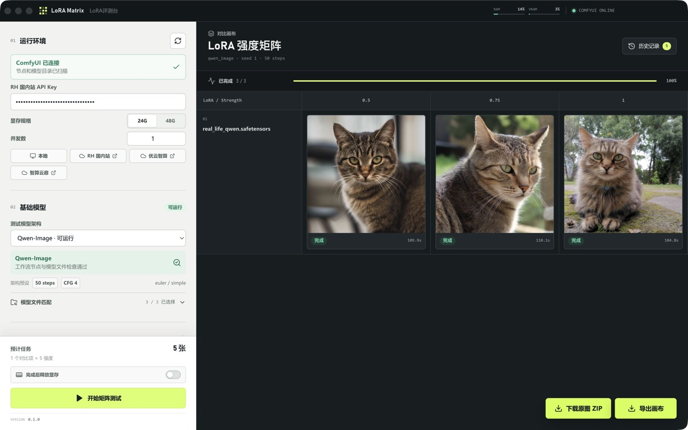

# LoRA Matrix

面向 ComfyUI 的本地 LoRA 强度矩阵评测台。固定 Prompt、Seed、模型和推理参数，只改变 LoRA 与强度，用一张矩阵更快完成视觉比较、复查与导出。

[访问官网](https://matrix.doxora.work/) · [下载最新版](https://github.com/DocWorkBox/LoRA-Matrix/releases/latest)

## 能做什么

- 连接本地、远程 ComfyUI 或 RH 国内站算力，读取节点、模型、LoRA 与资源状态。
- 自动匹配主模型、VAE 和 Text Encoder，也支持手动修正模型文件。
- 一次选择 1–9 个 LoRA，按起始、结束和步进值生成强度矩阵。
- 固定 Prompt、Seed、尺寸、Steps、CFG、Sampler 和 Scheduler，减少对比变量。
- 支持原模型基准、参考图、加速 LoRA、KV Cache 和 LoRA 架构校验。
- 本地保存最近 50 次任务；远程服务器关闭后，已缓存结果仍可从历史记录查看。
- 下载单张原图、全部原图 ZIP，或导出 3840 × 2160 的 4K PNG 对比画布。

## 下载

请从 [GitHub Releases](https://github.com/DocWorkBox/LoRA-Matrix/releases) 获取正式版本。发布资产以 Releases 页面实际列表为准。

| 平台 | 要求 | 当前状态 |
| --- | --- | --- |
| macOS | Apple Silicon（M1 及更新芯片） | 提供单个 DMG |
| Windows | Windows 10/11 x64 | 正在重新打包 |

> LoRA Matrix 不内置 ComfyUI、模型或自定义节点。使用前请先启动自己的本地或远程 ComfyUI。

### macOS 首次打开

当前 macOS 版本尚未使用 Apple Developer ID 签名或公证。如果系统阻止启动，请在 Finder 中右键 `LoRA Matrix.app`，选择“打开”，再确认一次。

## 基本使用

1. 启动 ComfyUI，或准备好远程 ComfyUI / RH 国内站 API Key。
2. 在 LoRA Matrix 中连接服务，等待节点和模型目录扫描完成。
3. 选择模型架构、模型文件、LoRA、提示词和强度范围。
4. 开始矩阵测试，在画布中比较结果。
5. 下载原图、导出 4K 对比图，或从历史记录重新打开任务。

## 模型范围

首版覆盖 FLUX.1、FLUX.1 Kontext、FLUX.2、SD 1.5、SDXL、Chroma、Qwen Image、Qwen Image Edit、Anima、FireRed、Z-Image、Klein、Boogu、Ideogram4 与 Krea 2 图像模型。

## 产品链接

- 官网：[https://matrix.doxora.work/](https://matrix.doxora.work/)
- 最新版：[https://github.com/DocWorkBox/LoRA-Matrix/releases/latest](https://github.com/DocWorkBox/LoRA-Matrix/releases/latest)
- 全部版本：[https://github.com/DocWorkBox/LoRA-Matrix/releases](https://github.com/DocWorkBox/LoRA-Matrix/releases)

本仓库用于托管 LoRA Matrix 的最终发布产品和版本说明，不作为源代码仓库使用。
